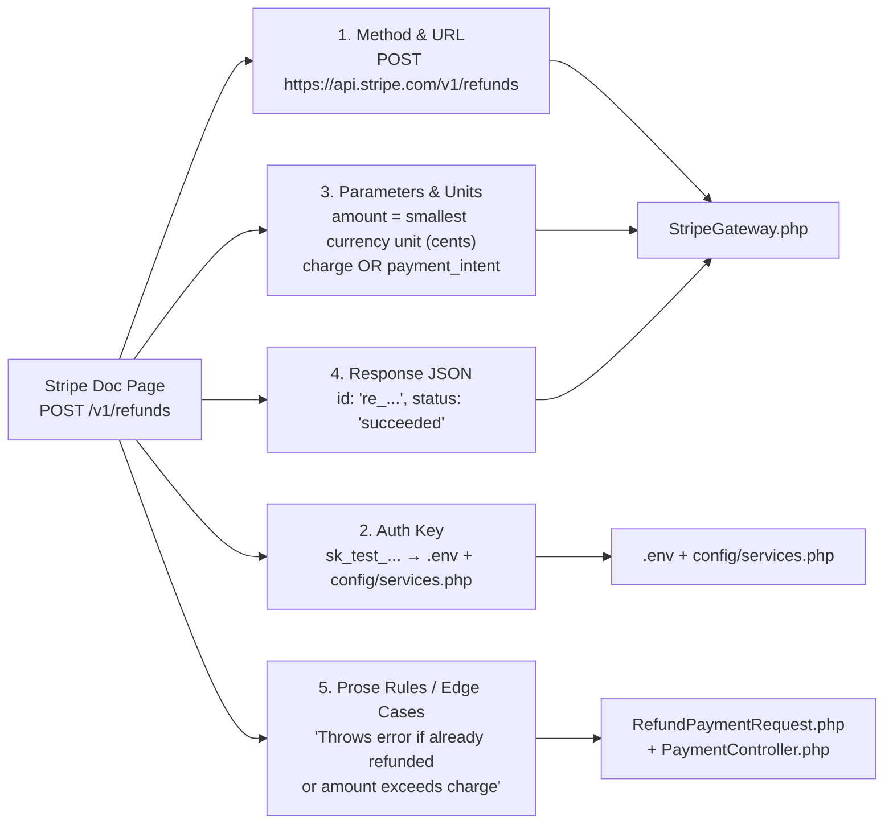

# From 2-Line Payment Docs to Production Code (Backend + Frontend Guide)

When you open Stripe, Paymob, or MyFatoorah documentation, they usually show a **tiny 2-line code snippet** like this (from Stripe's `Create a refund` page):

```php
$stripe = new \Stripe\StripeClient('sk_test_51...');
$refund = $stripe->refunds->create(['charge' => '{{CHARGE_ID}}']);
```

That 2-line snippet only shows **the raw API call**. It does **not** show authentication config, validation, RBAC security, database transactions, idempotency, error handling, or how React talks to it.

This guide shows you **step by step** how to read ANY payment documentation page and translate those 2 lines into **production-ready Backend (Laravel) + Frontend (React)** code in this project.

---

## 1. How to Dissect a Payment Doc Page (Using Stripe's `Create a refund` Page)

Every payment API doc page has **5 hidden building blocks**. Here is how you extract all 5 from a single doc page:



### Reading the 5 Clues on Stripe's Refund Page:
1. **Endpoint (`POST /v1/refunds`):**
   - Base URL is `https://api.stripe.com` → full URL is `https://api.stripe.com/v1/refunds`.
2. **Auth (`sk_test_...`):**
   - **Never** hardcode keys in PHP. Put `STRIPE_SECRET_KEY=sk_test_...` in `backend/.env` and read it via `config('services.stripe.secret')`.
3. **Parameters (`amount`, `charge`, `payment_intent`):**
   - Notice the doc says: *"A positive integer in the **smallest currency unit**"*.
   - In USD, `$10.00` = `1000` cents → in PHP we MUST convert: `(int) round($amount * 100)`.
   - Notice the doc says: *"you must specify a Charge (`ch_...`) or a PaymentIntent (`pi_...`)"*.
   - So in our code we detect the prefix dynamically:
     ```php
     $paramKey = str_starts_with($transactionId, 'pi_') ? 'payment_intent' : 'charge';
     ```
4. **Response JSON (`"id": "re_..."`, `"status": "succeeded"`):**
   - Every gateway returns different JSON keys (`id` in Stripe, `Data.RefundReference` in MyFatoorah).
   - Our `StripeGateway` **normalizes** it into our app's standard shape:
     ```php
     ['success' => true, 'refund_id' => $response->json('id'), 'status' => 'refunded', ...]
     ```
5. **The Warning Sentence in the Text:**
   - The doc warns: *"This method will throw an error when called on an already-refunded charge, or when trying to refund more money than is left."*
   - That tells you the exact **guard clauses** to write in `PaymentController::refund()` BEFORE calling Stripe:
     - Check `$order->payment_status === 'refunded'` → return `422` immediately.
     - Check `$amount > $order->total_amount` → return `422` immediately.

---

## 2. Official SDK vs. Laravel `Http` Client (Both Are Identical!)

Stripe docs default to their PHP SDK (`composer require stripe/stripe-php`), whereas our codebase uses Laravel's built-in `Http` client (zero extra packages). Both send the **exact same HTTP request**:

| Approach | Code | When to Use |
|---|---|---|
| **Stripe PHP SDK** (from docs) | `$stripe = new \Stripe\StripeClient(config('services.stripe.secret'));`<br>`$refund = $stripe->refunds->create(['payment_intent' => $txId, 'amount' => 1000]);` | When you only use Stripe and want typed SDK objects. |
| **Laravel `Http` Client** (used in `StripeGateway.php`) | `Http::withBasicAuth($this->secret, '')->asForm()->post('https://api.stripe.com/v1/refunds', ['payment_intent' => $txId, 'amount' => 1000]);` | Best for **multi-gateway** apps (Stripe + Paymob + MyFatoorah) — zero dependency bloat, unified timeouts & testing. |

---

## 3. Step-by-Step Walkthrough #1: Charge a Customer (`POST /v1/payment_intents`)

### Step 1 — What Stripe Docs Show (2 lines)
```php
$stripe->paymentIntents->create([
  'amount' => 2000,
  'currency' => 'usd',
  'automatic_payment_methods' => ['enabled' => true],
]);
```

### Step 2 — Store Keys Safely (`backend/.env` & `backend/config/services.php`)
```env
# backend/.env
STRIPE_PUBLIC_KEY=pk_test_...
STRIPE_SECRET_KEY=sk_test_...
STRIPE_WEBHOOK_SECRET=whsec_...
```
```php
// backend/config/services.php
'stripe' => [
    'key' => env('STRIPE_PUBLIC_KEY'),
    'secret' => env('STRIPE_SECRET_KEY'),
    'webhook_secret' => env('STRIPE_WEBHOOK_SECRET'),
],
```

### Step 3 — Wrap the Call in `StripeGateway::charge()` (`backend/app/Services/Payments/StripeGateway.php`)
Instead of calling Stripe directly from a controller, we isolate it inside `StripeGateway` (implements `PaymentGatewayInterface`):
```php
$amountCents = (int) round(((float) $data['amount']) * 100);

$response = Http::withBasicAuth($this->secret, '')
    ->asForm()
    ->timeout(15)
    ->withHeaders(['Idempotency-Key' => $idempotencyKey])
    ->post('https://api.stripe.com/v1/payment_intents', [
        'amount' => $amountCents,
        'currency' => strtolower($data['currency'] ?? 'usd'),
        'automatic_payment_methods[enabled]' => 'true',
        'metadata[order_id]' => (string) $data['order_id'],
    ]);
```
**What we added beyond the 2-line doc snippet:**
- `->timeout(15)` so a slow gateway never hangs PHP-FPM workers forever.
- `Idempotency-Key` header so network retries never double-charge the customer.
- `metadata[order_id]` so when Stripe sends the async webhook later, we know **which order** was paid.
- `retryable` flag: `true` on `5xx`/`429`, `false` on `402` card declines.

### Step 4 — Validate & Orchestrate in Backend (`ChargePaymentRequest` + `PaymentController::charge`)
1. `ChargePaymentRequest` validates `order_id`, `gateway`, `idempotency_key`, and strips raw card/CVC via `safeMetadata()`.
2. `PaymentController::charge()` loads `Order` from MySQL (never trusts frontend price!), verifies `order.user_id === auth('api')->id()`, runs `PaymentService::processPayment()`, and calls `OrderSettlementService::settle()` **only when `status === 'completed'`**.

### Step 5 — Connect React Frontend (`frontend/src/components/Cart/PaymentPage.jsx`)
The frontend **never** calls `api.stripe.com` with your secret key. It calls **your Laravel API**:
```jsx
// 1. Create authoritative unpaid order from DB cart
const orderRes = await apiClient.post(AppURL.Orders, {
  shipping_address: `${formData.fullName}, ${formData.address}`,
  payment_method: selectedMethod, // 'stripe' | 'paymob' | 'myfatoorah'
  coupon_code: appliedCoupon?.code || null,
});

// 2. Charge using a stable idempotency key (same key if user double-clicks!)
const chargeRes = await apiClient.post(AppURL.PaymentCharge, {
  order_id: orderRes.data.data.order_id,
  gateway: selectedMethod,
  idempotency_key: stableKey,
  metadata: { customer_email: formData.email, card_last4: rawDigits.slice(-4) },
});

// 3. Handle response
if (chargeRes.data.payment_url) {
  window.location.href = chargeRes.data.payment_url; // Redirect flow (Paymob / MyFatoorah)
} else if (chargeRes.data.success) {
  setPaymentResult(chargeRes.data); // Show receipt + refresh cart
}
```

> **Live Stripe Card Element Upgrade (Production PCI-DSS):**
> When switching from Sandbox to real credit cards on Stripe, install `@stripe/stripe-js` and `@stripe/react-stripe-js`, mount `<CardElement />`, call `stripe.confirmCardPayment(chargeRes.data.client_secret, { payment_method: { card } })` in React, and let `POST /api/payment/webhook?gateway=stripe` settle the order!

---

## 4. Step-by-Step Walkthrough #2: Refund an Order (`POST /v1/refunds` — Your Screenshot!)

### Step 1 — Backend Route (`backend/routes/api.php`)
```php
Route::middleware('auth:api')->group(function () {
    Route::post('/payment/refund', [PaymentController::class, 'refund']);
});
```

### Step 2 — Admin Authorization & Validation (`backend/app/Http/Requests/Api/Payments/RefundPaymentRequest.php`)
```php
public function authorize(): bool
{
    $user = auth('api')->user();
    return $user && ($user->role === 'admin' || $user->hasRole(['admin', 'super_admin']));
}

public function rules(): array
{
    return [
        'gateway'        => ['required', 'string', 'in:stripe,paymob,myfatoorah'],
        'transaction_id' => ['required', 'string', 'max:255'],
        'amount'         => ['required', 'numeric', 'min:0.01'],
        'order_id'       => ['nullable', 'integer', 'exists:orders,id'],
    ];
}
```

### Step 3 — Business Guards in Controller (`backend/app/Http/Controllers/API/PaymentController.php`)
```php
if ($order->payment_status === 'refunded') {
    return response()->json(['success' => false, 'message' => 'Already refunded.'], 422);
}
if ((float) $validated['amount'] > (float) $order->total_amount) {
    return response()->json(['success' => false, 'message' => 'Exceeds order total.'], 422);
}

$result = $this->paymentService->refund($validated['gateway'], $validated['transaction_id'], (float) $validated['amount']);

if (!empty($result['success']) && $order) {
    $this->settlementService->markRefunded($order); // payment_status = 'refunded', status = 'cancelled'
}
```

### Step 4 — Gateway Execution (`backend/app/Services/Payments/StripeGateway.php`)
This is where Stripe's 2-line doc snippet finally lives:
```php
$paramKey = str_starts_with($transactionId, 'pi_') ? 'payment_intent' : 'charge';

$response = Http::withBasicAuth($this->secret, '')
    ->asForm()
    ->timeout(15)
    ->post('https://api.stripe.com/v1/refunds', [
        $paramKey => $transactionId,
        'amount'  => (int) round($amount * 100), // Dollars -> Cents!
    ]);

return [
    'success'        => $response->successful(),
    'refund_id'      => $response->json('id'),        // "re_1Nispe2eZvKYlo2Cd31jOCgZ"
    'transaction_id' => $transactionId,
    'amount'         => $amount,
    'status'         => $response->successful() ? 'refunded' : 'failed',
    'error'          => $response->json('error.message'),
];
```

### Step 5 — Calling Refund from Frontend / Admin Panel
```javascript
const handleRefund = async (order) => {
  const res = await apiClient.post('/payment/refund', {
    gateway: order.payment_method,      // 'stripe'
    transaction_id: order.transaction_id, // 'pi_...' or 'ch_...'
    amount: order.total_amount,          // 49.99 (backend converts to 4999 cents)
    order_id: order.id,
  });

  if (res.data.success) {
    alert(`Refunded! Reference: ${res.data.refund_id}`);
  }
};
```

---

## 5. The 6-Layer Checklist (Use This for ANY New Payment Gateway)

Whenever you open a new gateway's docs (Stripe, Paymob, MyFatoorah, PayPal, Tap, Moyasar) and see a 2-line snippet, map it across these **6 exact layers** in your codebase:

| Layer | File in Your Project | Responsibility |
|---|---|---|
| **1. Config** | `backend/config/services.php` + `.env` | Store Base URL, Public/Secret Keys, Webhook Secret. |
| **2. Request** | `app/Http/Requests/Api/Payments/*Request.php` | Auth (`authorize()`), input rules, PCI field stripping. |
| **3. Controller** | `app/Http/Controllers/API/PaymentController.php` | Load authoritative `Order` from DB, enforce ownership/ceilings, return JSON. |
| **4. Pipeline** | `PaymentProcessor` + `IdempotencyHandler` + `RetryHandler` | Prevent double-charges, validate payload integrity, retry transient 5xx only. |
| **5. Gateway** | `app/Services/Payments/*Gateway.php` | **Put the 2-line doc API call here** + convert units (cents vs float) + verify webhook HMAC + normalize response. |
| **6. Frontend** | `frontend/src/components/Cart/PaymentPage.jsx` | Call your Laravel API with stable `idempotency_key`, handle `payment_url` redirect or `client_secret` / receipt UI. |
