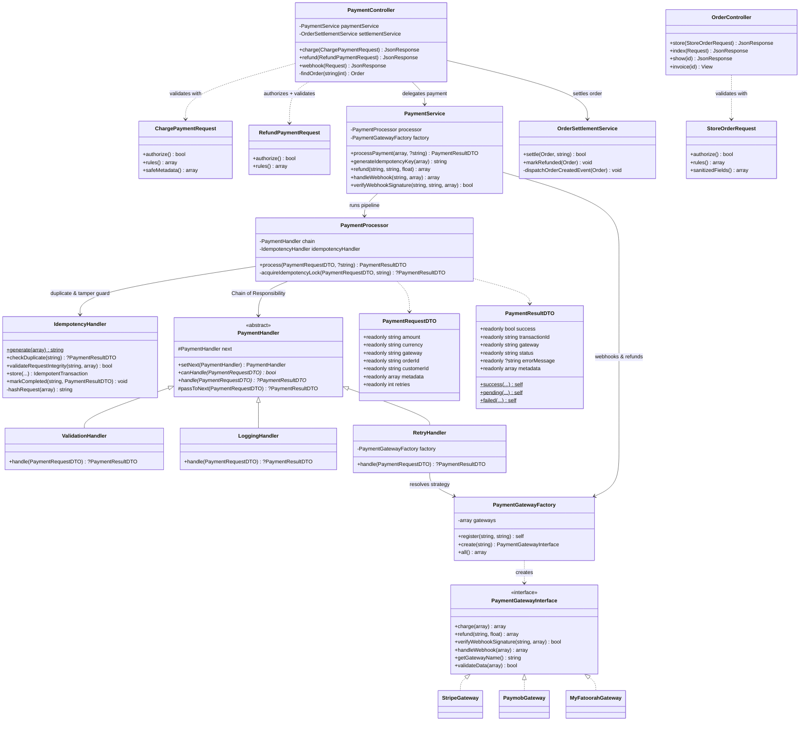
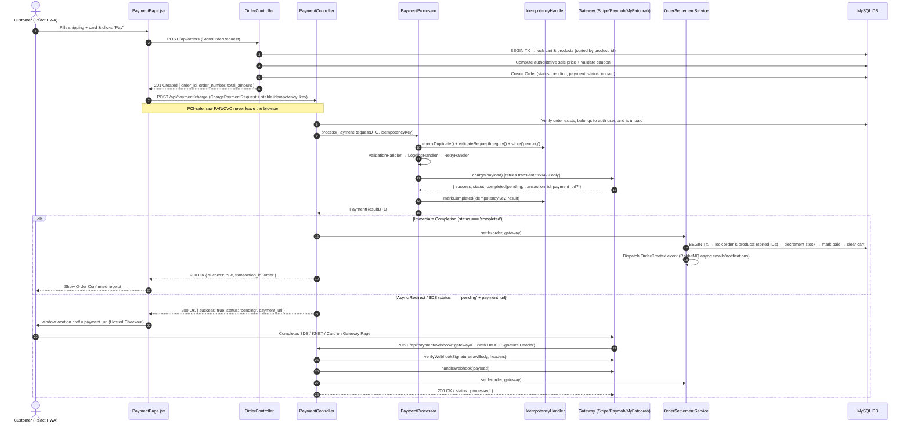

# Multi-Gateway Payment System — Complete Architecture, Code Guide & Gateway Integration Manual

This document is the complete engineering reference for the e-commerce payment system across the **Laravel 10 Backend** and **React 18 PWA Frontend**. It covers:
1. Full end-to-end payment cycle & sequence diagrams (Sync + Async Redirect/Webhook)
2. Class diagram showing how every FormRequest, Controller, Service, Handler, Factory, DTO, and Gateway connects
3. Function-by-function deep dive: how every method works, where it is used, and the **engineering tricks** inside each one
4. Official gateway documentation links (Stripe, Paymob, MyFatoorah) mapped directly to our PHP methods
5. Playbook: **How to search & read any payment gateway's docs** to add a new provider in under 30 minutes
6. `.env` setup & Sandbox Test Card Matrix

---

## 1. Class Architecture Diagram (How Everything Connects)



---

## 2. Full End-to-End Payment Cycle (Sequence Diagram)



---

## 3. Deep Dive: Every Class, Function, Usage & Engineering Tricks

### A. FormRequests (Validation & Authorization Layer)

#### 1. `ChargePaymentRequest` (`backend/app/Http/Requests/Api/Payments/ChargePaymentRequest.php`)
- **Used by:** `PaymentController::charge()`
- **`authorize()`**: Ensures caller is authenticated on the `api` Passport guard.
- **`rules()`**: Whitelists `gateway` strictly to `stripe,paymob,myfatoorah` and caps `retries` to `1..3` (prevents DoS via `retries: 9999`).
- **`safeMetadata()` (Trick — PCI-DSS Defense-in-Depth):**
  Explicitly calls `unset($metadata['card_number'], $metadata['pan'], $metadata['cvc'], $metadata['cvv'])`. Even if a buggy or malicious client sends raw card numbers in `metadata`, they are stripped before touching logs, DTOs, or `idempotent_transactions.response`.

#### 2. `RefundPaymentRequest` (`backend/app/Http/Requests/Api/Payments/RefundPaymentRequest.php`)
- **Used by:** `PaymentController::refund()`
- **`authorize()` (Trick — RBAC Gate at Request Boundary):**
  Checks `$user->role === 'admin' || $user->hasRole(['admin', 'super_admin'])`. Laravel automatically rejects regular customers with `403 Forbidden` before controller code even executes.

#### 3. `StoreOrderRequest` (`backend/app/Http/Requests/Api/Orders/StoreOrderRequest.php`)
- **Used by:** `OrderController::store()`
- **`sanitizedFields()` (Trick — Stored XSS Prevention):**
  Runs `strip_tags()` on `shipping_address`, `billing_address`, and `notes` so malicious `<script>` payloads can never render in Admin order tables or PDF invoices.

---

### B. Controllers (Thin HTTP Orchestration)

#### 4. `OrderController::store(StoreOrderRequest $request)` (`backend/app/Http/Controllers/API/OrderController.php`)
- **What it does:** Converts the user's cart into an authoritative `unpaid` order.
- **Tricks:**
  1. **Zero-Trust Pricing:** Never trusts prices from the frontend. Computes `$unitPrice` directly from `products` table, honoring active `special_price` (`special_price > 0 && special_price < price`).
  2. **Deadlock-Free Pessimistic Locking:** Sorts `$cartItems->sortBy('product_id')` *before* calling `Product::where('id', ...)->lockForUpdate()`. If Transaction A buys `[Product 1, Product 2]` and Transaction B buys `[Product 2, Product 1]`, sorting guarantees both lock Product 1 first, eliminating circular-wait MySQL deadlocks.
  3. **Atomic Coupon Locking:** Locks the `Coupon` row (`lockForUpdate()`) so two simultaneous checkouts cannot bypass `max_uses`.

#### 5. `PaymentController` (`backend/app/Http/Controllers/API/PaymentController.php`)
- **`charge(ChargePaymentRequest $request)`**:
  - Enforces **Zero-Trust Ownership**: `(int) $order->user_id !== (int) auth('api')->id()` → `403`.
  - **Double-Charge Guard:** If `$order->payment_status === 'paid'`, short-circuits immediately with `200 OK`.
  - **Pending vs. Completed Split (Critical Trick):** Only calls `$this->settlementService->settle()` when `$result->success && $result->status === 'completed'`. Redirect gateways (`status === 'pending'`) wait for the verified webhook so unpaid users never steal inventory.
- **`refund(RefundPaymentRequest $request)`**:
  - Cross-checks `IdempotentTransaction` / `Order` to ensure `refund_amount <= order.total_amount` and rejects double refunds (`payment_status === 'refunded'`).
- **`webhook(Request $request)`**:
  - Calls `verifyWebhookSignature($gateway, $request->getContent(), $request->headers->all())` **before** parsing or trusting any JSON field. Uses raw `$request->getContent()` (NOT `json_encode($request->all())`, because key reordering breaks HMAC!).

---

### C. Core Payment Engine (`backend/app/Services/Payments/`)

#### 6. `PaymentService` (`PaymentService.php`)
- **Pattern:** Facade over `PaymentProcessor` and `PaymentGatewayFactory`.
- **Methods:**
  - `processPayment(array $data, ?string $idempotencyKey): PaymentResultDTO` — builds `PaymentRequestDTO` and runs `PaymentProcessor::process()`.
  - `generateIdempotencyKey(array $data): string` — delegates to `IdempotencyHandler::generate()`.
  - `refund(string $gateway, string $transactionId, float $amount): array` — resolves gateway via factory and calls `refund()`.
  - `verifyWebhookSignature(string $gateway, string $rawBody, array $headers): bool` — resolves gateway and verifies HMAC.
  - `handleWebhook(string $gateway, array $payload): array` — normalizes gateway-specific webhook payload into a unified `['success', 'order_id', 'transaction_id']` array.

#### 7. `PaymentProcessor` (`PaymentProcessor.php`)
- **Pattern:** Orchestrator + Chain of Responsibility (`ValidationHandler → LoggingHandler → RetryHandler`).
- **`acquireIdempotencyLock()` (Trick — Unique Constraint Concurrency Lock):**
  Inserts a `pending` row into `idempotent_transactions` (which has a `UNIQUE` index on `idempotency_key`). If two identical clicks arrive at the exact same millisecond, MySQL rejects the second insert with a `QueryException`, which we catch and cleanly return the cached/in-progress status instead of charging the card twice!

#### 8. `IdempotencyHandler` (`IdempotencyHandler.php`)
- **`generate(array $data)`**: Deterministic `hash('sha256', "order:{$orderId}:customer:{$customerId}:gw:{$gateway}")`.
- **`hashRequest(array $data)` (Trick — Tamper Detection):**
  Normalizes both snake_case (`order_id`) and camelCase (`orderId`) keys + formats amount with `number_format(..., 2, '.', '')` so `"100"` and `"100.00"` hash identically, then compares with constant-time `hash_equals()` in `validateRequestIntegrity()` to block parameter tampering under an existing key.
- **`checkDuplicate(string $idempotencyKey)`**: Looks up records within the last 24h (`recent()` scope) and replays the cached `PaymentResultDTO` (`success`, `pending`, or `failed`).

#### 9. Chain of Responsibility Handlers (`Handlers/`)
- **`ValidationHandler::handle()`**: Rejects `amount <= 0`, empty `gateway`, or missing `customerId` before any external HTTP call is made.
- **`LoggingHandler::handle()`**: Structured audit log of `order_id`, `customer_id`, `amount`, `currency`, `gateway` (zero PCI fields).
- **`RetryHandler::handle()` (Tricks — Smart Retry + Exponential Backoff + Jitter):**
  1. **Never retries deterministic failures:** Checks `($response['retryable'] ?? false) === false`. Card declines (`insufficient_funds`, `expired_card`) fail fast on Attempt 1 (no wasted latency or rate-limit burn).
  2. **Exponential Backoff + Random Jitter:** On transient 5xx/429/network exceptions, sleeps `(2^(attempt-1) * 200) + random_int(20, 100)` ms (~220ms → ~460ms → ~880ms). Jitter prevents thousands of failed requests from retrying at the exact same millisecond (thundering herd).

#### 10. `OrderSettlementService` (`OrderSettlementService.php`)
- **`settle(Order $order, string $gateway): bool`**:
  - Acquires `lockForUpdate()` on `Order` and checks `payment_status === 'paid'` *inside* the lock (guards against race between sync return and webhook arriving simultaneously).
  - Locks `Product` rows in ascending `product_id` order to prevent deadlocks.
  - Dispatches `OrderCreated` event **after** `DB::transaction()` commits (Trick: never fire queue/RabbitMQ events inside an open DB transaction, or consumers may read uncommitted data or send emails for rolled-back transactions!).

#### 11. `PaymentGatewayFactory` (`PaymentGatewayFactory.php`)
- **Pattern:** Registry + Factory. Maps `'stripe'`, `'paymob'`, `'myfatoorah'` to their classes and resolves them via Laravel's IoC container `app($className)`.

---

## 4. Official Gateway Docs → Exact Method Mapping

### 1. Stripe (`StripeGateway.php`)
- **Official Portal & API Keys (Test Mode):** https://dashboard.stripe.com/test/apikeys
- **API Reference:** https://docs.stripe.com/api

| Our PHP Method | Official Stripe Endpoint | Official Doc Link | Key Details / Tricks |
|---|---|---|---|
| `chargeViaStripeApi()` | `POST https://api.stripe.com/v1/payment_intents` | [Create PaymentIntent](https://docs.stripe.com/api/payment_intents/create) | Auth: Basic Auth (`sk_test_...`, empty password). Content-Type: `asForm()`. Amount MUST be integer **cents** (`round($amount * 100)`). Header: `Idempotency-Key`. |
| `refund()` | `POST https://api.stripe.com/v1/refunds` | [Create Refund](https://docs.stripe.com/api/refunds/create) | Pass `payment_intent` (for `pi_...`) or `charge` (for `ch_...`) + `amount` in cents. |
| `verifyWebhookSignature()` | Header `Stripe-Signature: t=...,v1=...` | [Verify Webhook Signatures](https://docs.stripe.com/webhooks#verify-official-libraries) | Compute `hash_hmac('sha256', "{$t}.{$rawBody}", $webhookSecret)`. Reject if `abs(time() - $t) > 300` (prevents replay attacks) and compare via `hash_equals()`. |
| `handleWebhook()` | Event `payment_intent.succeeded` | [Webhook Events](https://docs.stripe.com/api/events/types) | Order ID lives at `$payload['data']['object']['metadata']['order_id']`. |

---

### 2. Paymob (`PaymobGateway.php`)
- **Official Sandbox Dashboard:** https://accept.paymob.com/
- **API Reference:** https://developers.paymob.com/egypt/api-reference-guide/create-intention-payment-api

| Our PHP Method | Official Paymob Endpoint | Official Doc Link | Key Details / Tricks |
|---|---|---|---|
| `chargeViaPaymobIntention()` | `POST {base_url}/v1/intention/` | [Create Intention API](https://developers.paymob.com/egypt/api-reference-guide/create-intention-payment-api) | Auth header: `Authorization: Token {PAYMOB_SECRET_KEY}`. Amount in **piasters/cents** (`amount * 100`). Returns `client_secret` → build Hosted Checkout URL: `{base_url}/unifiedcheckout/?publicKey={PK}&clientSecret={CS}`. |
| `refund()` | `POST {base_url}/api/acceptance/void_refund/refund` | [Refund Transaction](https://developers.paymob.com/egypt/api-reference-guide/refund-transaction) | Pass `transaction_id` + `amount_cents`. |
| `verifyWebhookSignature()` | HMAC-SHA512 over 20 canonical fields | [HMAC Calculation](https://developers.paymob.com/egypt/tutorials/hmac-calculation) | **Critical Trick:** Paymob does NOT hash the raw JSON string — it concatenates 20 specific fields in **strict alphabetical order** (`amount_cents`, `created_at`, `currency`, `error_occured`, ..., `success`), converting booleans to literal `'true'`/`'false'`, then computes `hash_hmac('sha512', $concat, $hmacSecret)`. |
| `handleWebhook()` | Transaction Processed Callback | [Transaction Callbacks](https://developers.paymob.com/egypt/manage-callback/transaction-callbacks) | Order ID is at `$payload['obj']['order']['merchant_order_id']`; success is `$payload['obj']['success'] === true`. |

---

### 3. MyFatoorah (`MyFatoorahGateway.php`)
- **Official Test Token & Sandbox:** https://docs.myfatoorah.com/docs/test-token
- **API Reference:** https://docs.myfatoorah.com/docs/api-overview

| Our PHP Method | Official MyFatoorah Endpoint | Official Doc Link | Key Details / Tricks |
|---|---|---|---|
| `chargeViaMyFatoorahApi()` | `POST {base_url}/v2/SendPayment` | [SendPayment v2](https://docs.myfatoorah.com/docs/send-payment) | Auth: `Bearer {MYFATOORAH_API_KEY}`. Amount is **major units** (float, e.g. `49.99`, NOT cents!). Pass `NotificationOption: 'LNK'` to get `Data.InvoiceURL` for redirect. Store `order_id` in `CustomerReference`. |
| `refund()` | `POST {base_url}/v2/MakeRefund` | [MakeRefund v2](https://docs.myfatoorah.com/docs/make-refund) | Pass `KeyType: 'InvoiceId'`, `Key: $transactionId`, `Amount`. |
| `verifyWebhookSignature()` | Header `MyFatoorah-Signature` | [Webhook Signature](https://docs.myfatoorah.com/docs/webhook-v2) | Base64-encoded raw HMAC-SHA256: `base64_encode(hash_hmac('sha256', $rawBody, $secret, true))`. |
| `handleWebhook()` | Event `TransactionsStatusChanged` | [Webhook v2](https://docs.myfatoorah.com/docs/webhook-v2) | Order ID is at `$payload['Data']['CustomerReference']`; success when `TransactionStatus === 'SUCCESS'`. |

---

## 5. How to Search Any Payment Gateway's Docs (Senior Engineer Playbook)

Whenever you need to integrate a **new gateway** (e.g., PayPal, Tap, Moyasar, Fawry, Tamara) into this codebase, open their docs and search for these exact **6 terms** in order:

1. **Search `"Authentication"` or `"API Keys"`**
   - Find the Sandbox vs. Live base URL and header format (`Bearer {token}` vs. `Basic Auth` vs. `Token {secret}`).
   - Add them to `backend/config/services.php` and `.env`.
2. **Search `"Create Payment"` / `"Payment Intent"` / `"Checkout Session"` / `"SendPayment"`**
   - Check 3 things immediately:
     - **Amount unit:** Minor units/cents (`1000` = $10.00) or major float (`10.00`)?
     - **Flow type:** Synchronous card charge (`status: 'completed'`) OR Hosted Checkout redirect (`status: 'pending'` + `payment_url`)?
     - **Custom reference field:** Where do you attach your `order_id`? (`metadata.order_id`, `special_reference`, `CustomerReference`).
   - Map this directly to `YourGateway::charge(array $data): array`.
3. **Search `"Idempotency"`**
   - Find their idempotency header (e.g. `Idempotency-Key`, `X-Request-Id`) and pass `$data['metadata']['idempotency_key']`.
4. **Search `"Webhook"` + `"Signature"` or `"HMAC"`**
   - Find: (a) Header name, (b) Hash algorithm (`sha256` vs `sha512`), (c) Input format (raw body vs. `timestamp.rawBody` vs. sorted field list), (d) Encoding (hex vs. base64).
   - Map this directly to `YourGateway::verifyWebhookSignature()` and `handleWebhook()`.
5. **Search `"Refund"`**
   - Check if refunds require `transaction_id`, `invoice_id`, or `payment_intent_id` and whether partial refunds are supported.
   - Map to `YourGateway::refund()`.
6. **Search `"Test Cards"` or `"Sandbox"`**
   - Grab their success card, 3DS card, and declined card numbers, then register your new class in `PaymentGatewayFactory`:
     ```php
     $this->register('tap', TapGateway::class);
     ```
   - Add `'tap'` to the `in:` validation rule in `ChargePaymentRequest`, `RefundPaymentRequest`, and `StoreOrderRequest`. Everything else (idempotency, retries, stock locking, webhooks, RabbitMQ notifications) works automatically!

---

## 6. `.env` Configuration & Test Card Matrix

### Environment Variables (`backend/.env`)
```env
# Stripe (Leave empty to use Interactive Sandbox Mode)
STRIPE_PUBLIC_KEY=pk_test_...
STRIPE_SECRET_KEY=sk_test_...
STRIPE_WEBHOOK_SECRET=whsec_...

# Paymob Unified Intention API
PAYMOB_BASE_URL=https://accept.paymob.com
PAYMOB_SECRET_KEY=egy_sk_test_...
PAYMOB_PUBLIC_KEY=egy_pk_test_...
PAYMOB_INTEGRATION_ID=1234567
PAYMOB_HMAC_SECRET=your_hmac_secret

# MyFatoorah v2 (Sandbox: https://apitest.myfatoorah.com | Live: https://api.myfatoorah.com)
MYFATOORAH_BASE_URL=https://apitest.myfatoorah.com
MYFATOORAH_API_KEY=your_myfatoorah_bearer_token
MYFATOORAH_WEBHOOK_SECRET=your_webhook_secret

FRONTEND_URL=http://localhost:3000
```

### Quick-Test Card Matrix (Frontend Checkout)
| Gateway | Scenario | Card Number | Expiry | CVC | Expected Behavior |
|---|---|---|---|---|---|
| **Stripe / Any** | Visa Success | `4242 4242 4242 4242` | `12/28` | `424` | Order confirmed, stock decremented, cart cleared |
| **Paymob** | Paymob Visa Success | `4987 6543 2109 8769` | `12/28` | `123` | Confirmed in sandbox (or redirects to Paymob Unified Checkout in live mode) |
| **MyFatoorah** | Visa / KNET Success | `4242 4242 4242 4242` | `12/28` | `123` | Confirmed in sandbox (or redirects to MyFatoorah InvoiceURL in live mode) |
| **Any** | Declined (Insufficient Funds) | `4000 0000 0000 9995` | `12/28` | `123` | Immediate `400` error (no retries), order stays `unpaid`, reusable on retry |
| **Any** | Expired Card | `4242 4242 4242 0002` | `01/22` | `123` | Immediate `400` expired card error |
