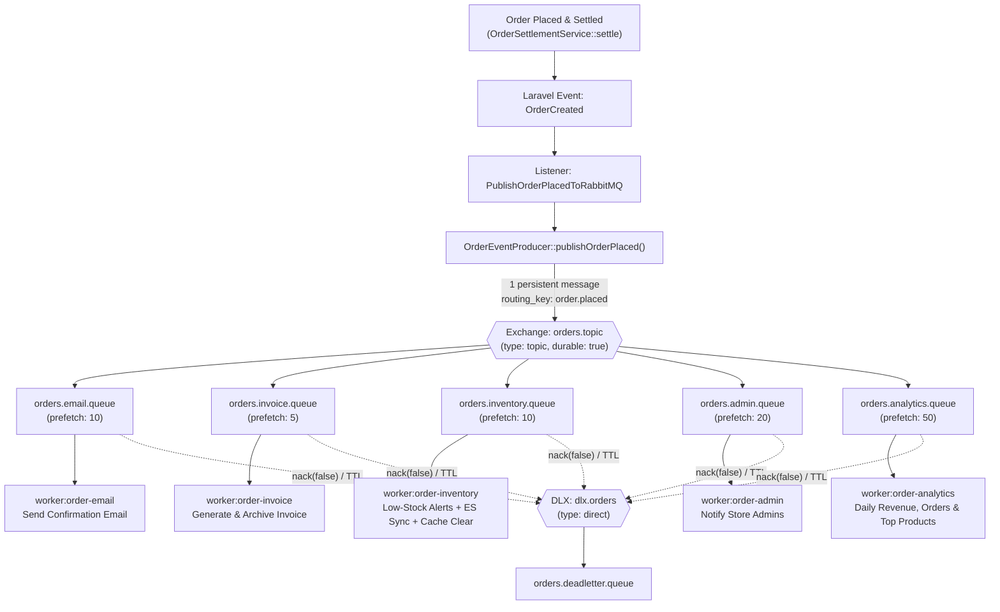
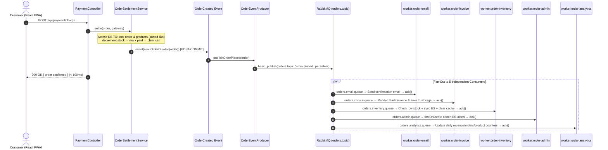

# Asynchronous Event-Driven Architecture with RabbitMQ — Complete Guide

This guide documents the complete **RabbitMQ Event-Driven Architecture** implemented in this e-commerce platform, focusing on the **Order Placed Fan-Out Pipeline (1 Event → 5 Independent Consumers)** and the **Catalog Async Pipeline (Image Optimization + Elasticsearch Sync)**.

---

## 1. Order Placed Fan-Out Architecture (1 Event → 5 Consumers)

When a customer places and settles an order, the HTTP checkout response returns immediately (`< 100ms`), while **1 single persistent event** (`order.placed`) is published to the durable `orders.topic` exchange and automatically fanned out by RabbitMQ into **5 independent queues**:



---

## 2. End-to-End Sequence Diagram



---

## 3. Deep Dive: Every Consumer, File & Engineering Trick

| # | Consumer Command | Queue | Prefetch QoS | File | Engineering Trick / Safeguard |
|---|---|---|---|---|---|
| 1 | `worker:order-email` | `orders.email.queue` | `10` | `OrderEmailWorkerCommand.php` | Sends HTML confirmation email off the checkout thread; safely catches SMTP outages in local dev without losing order flow. |
| 2 | `worker:order-invoice` | `orders.invoice.queue` | `5` | `OrderInvoiceWorkerCommand.php` | Renders `admin.orders.invoice` Blade template and archives to `storage/app/public/invoices/{order_number}.html` asynchronously. |
| 3 | `worker:order-inventory` | `orders.inventory.queue` | `10` | `OrderInventoryWorkerCommand.php` | **Zero-Oversell Split:** Atomic stock decrement stays in `OrderSettlementService::settle()` (`lockForUpdate`), while this async worker handles low-stock threshold alerts (`<= 5`), homepage cache invalidation, and Elasticsearch stock re-indexing. |
| 4 | `worker:order-admin` | `orders.admin.queue` | `20` | `OrderAdminWorkerCommand.php` | **Idempotent Alerts:** Uses `Notification::firstOrCreate()` keyed by `(user_id, title)` so message redelivery never spams duplicate admin notifications. |
| 5 | `worker:order-analytics` | `orders.analytics.queue` | `50` | `OrderAnalyticsWorkerCommand.php` | **Idempotent Revenue Counters:** Uses a 7-day cache dedup key (`analytics:processed:order:{id}`) so redelivered messages never double-count revenue or units sold. |

### Shared Production Safeguards in `RabbitMQConsumer.php` & `OrderEventProducer.php`
1. **Manual ACK (`no_ack = false`):** Messages are only removed from RabbitMQ after the consumer returns `true` and executes `$message->ack()`.
2. **Poison-Pill Dead-Letter Protection (`$message->nack(false)`):** Malformed JSON or unhandled exceptions reject *without* requeueing, routing the bad message cleanly into `dlx.orders` → `orders.deadletter.queue` instead of trapping workers in an infinite 100%-CPU requeue loop.
3. **Idle Heartbeat Loop:** Catches `AMQPTimeoutException` every 30s and `continue`s cleanly so long-running CLI workers never die when queues are idle.
4. **Post-Commit Event Dispatch:** `OrderCreated` is fired *after* `DB::transaction()` commits in `OrderSettlementService`, guaranteeing workers never read uncommitted rows.
5. **Graceful Broker-Offline Degradation:** `OrderEventProducer` wraps `publish()` in `try/catch (\Throwable)` so checkout never returns a `500` if RabbitMQ is temporarily stopped.

---

## 4. Bonus Pipeline: Async Product Catalog (`catalog.topic`)
In addition to the 5 Order Placed consumers, the same RabbitMQ infrastructure also offloads Admin product uploads:
- **`worker:image-optimizer`** (`catalog.image.optimize.queue`, prefetch `2`) — Generates 4 WebP sizes + 4 JPEG/PNG fallbacks + blur placeholder off the HTTP thread (`Admin\ProductController` saves only the raw original in `< 20ms`).
- **`worker:search-sync`** (`catalog.search.sync.queue`, prefetch `20`) — Asynchronously upserts/deletes products in Elasticsearch on create/update/delete.

---

## 5. How to Provision, Run & Test Locally

```powershell
# 1. Start RabbitMQ broker (Management UI: http://localhost:15672 | guest / guest)
docker compose up -d rabbitmq

# 2. Provision all exchanges, queues, DLQs & bindings from config/rabbitmq.php
php backend/artisan rabbitmq:setup

# 3. Start the 5 Order Placed consumers (run in separate terminals or Supervisor in production)
php backend/artisan worker:order-email
php backend/artisan worker:order-invoice
php backend/artisan worker:order-inventory
php backend/artisan worker:order-admin
php backend/artisan worker:order-analytics
```

### Verify End-to-End
1. Place an order on the React storefront (`http://localhost:3000/payment`) using test card `4242 4242 4242 4242`.
2. Watch all 5 worker terminals process the single `order.placed` event in parallel:
   - `worker:order-email` → `✓ Confirmation email processed`
   - `worker:order-invoice` → `✓ Generated invoice: storage/app/public/invoices/ORD-....html`
   - `worker:order-inventory` → `✓ Inventory reconciled & search synced` (plus `⚠ Low Stock Alert` if qty ≤ 5)
   - `worker:order-admin` → `✓ Notified N admin(s)`
   - `worker:order-analytics` → `✓ Analytics updated | Daily Orders & Revenue`
3. Open **http://localhost:15672/#/exchanges/%2F/orders.topic** to see all 5 bound queues and live message rates.
